# 配置表 編集操作マニュアル

対象読者: 管理者画面で配置表を編集する事務・管理者の方（PC操作を前提）
最終更新: 2026年10月

> このマニュアルは管理者画面の「配置表」タブの編集操作をまとめたものです。
> 画面写真はマニュアル作成用のサンプル現場「【マニュアル用】サンプル現場」を使って撮影しています。
> 配置表を編集できるのは **管理者・事務** のロールのみです。

---

## 目次

0. [画面の見方](#0-画面の見方)
1. [新しい現場を配置表に表示する](#1-新しい現場を配置表に表示する)
2. [作業員を配置する](#2-作業員を配置する)
3. [複数日をまとめて配置する](#3-複数日をまとめて配置する)
4. [配置を変更・解除する](#4-配置を変更解除する)
5. [コピー・切り取り・貼り付け](#5-コピー切り取り貼り付け)
6. [有給・休みなどの予定を入れる](#6-有給休みなどの予定を入れる)
7. [工期バーを動かす](#7-工期バーを動かす)
8. [現場の並び順を変える](#8-現場の並び順を変える)
9. [セルにコメントを付ける](#9-セルにコメントを付ける)
10. [会社行事・休日を登録する](#10-会社行事休日を登録する)
11. [表示週の切り替えとExcel出力](#11-表示週の切り替えとexcel出力)
12. [困ったとき](#12-困ったとき)
- [付録: ショートカット一覧](#付録-ショートカット一覧)

---

## 0. 画面の見方

管理者画面の上部メニューから **「配置表」** を開きます。

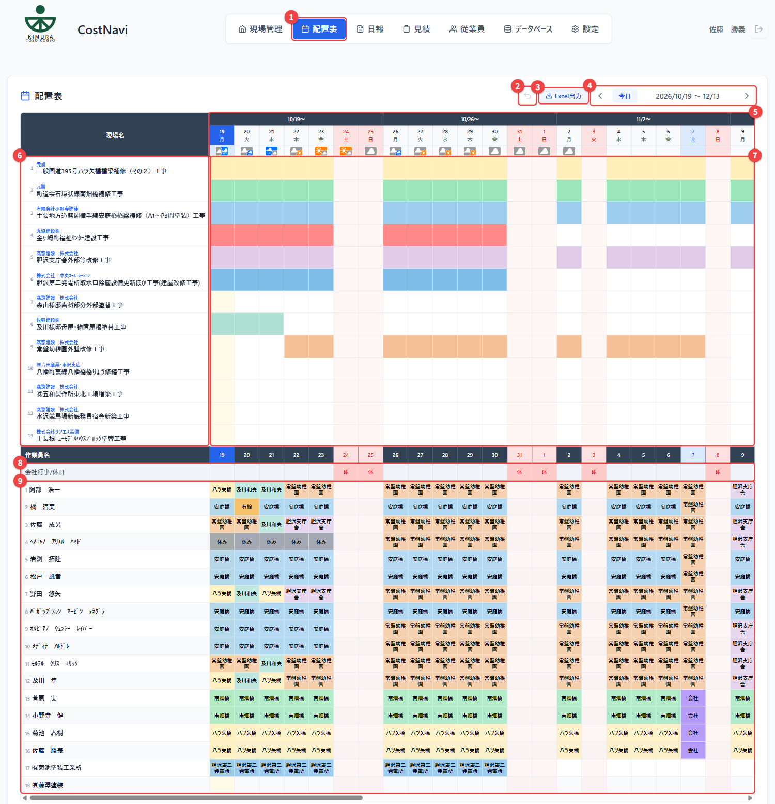

| 番号 | 名前 | 説明 |
|------|------|------|
| ① | 配置表タブ | 配置表の画面を開きます |
| ② | 元に戻す | 直前の配置操作を取り消します（Ctrl+Z と同じ） |
| ③ | Excel出力 | 配置表を Excel ファイルで出力します |
| ④ | 期間の切り替え | 前の週 / 今日 / 次の週 へ移動します |
| ⑤ | 日付の見出し | 日付と天気予報アイコン。**今日の日付は青色** で表示されます |
| ⑥ | 現場名の列 | 現場名と、その上に小さく元請名が表示されます |
| ⑦ | 工期バー | 各現場の工期（開始日〜終了日）を横棒で表示します |
| ⑧ | 会社行事/休日 の行 | 会社の休日や会議・行事を登録する行です |
| ⑨ | 作業員の行 | 作業員ごとに、日ごとの配置先を入力する行です |

- 画面には **8週間分（56日）** が表示されます。
- **土日・休日の列は薄い赤**、**今日の列は薄い黄色** で表示されます。

### 現場の詳細を確認する

現場名にマウスを乗せると、施工元請・担当職長・進捗状況・消化工数などの詳細が表示されます。

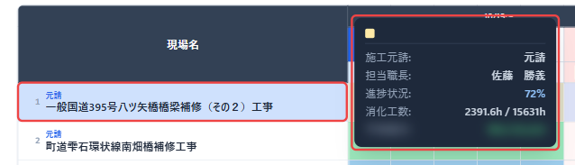

> ※ 写真ではツールチップ内の予測粗利をぼかしています。

---

## 1. 新しい現場を配置表に表示する

配置表に表示される現場は、**「現場管理」で登録した現場** です。新しい現場を配置表に出すには、まず現場管理で現場を追加します。

### 手順

1. **「現場管理」** タブを開き、**① 「新しい現場を追加」** をクリックします。

   

2. **②「見積」列に新しいカード** が追加されます。カードをクリックして詳細を開きます。

   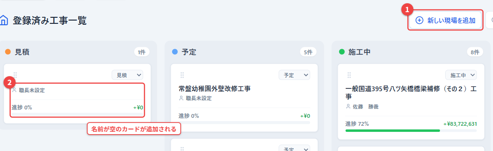

3. 現場の基本情報を入力します。

   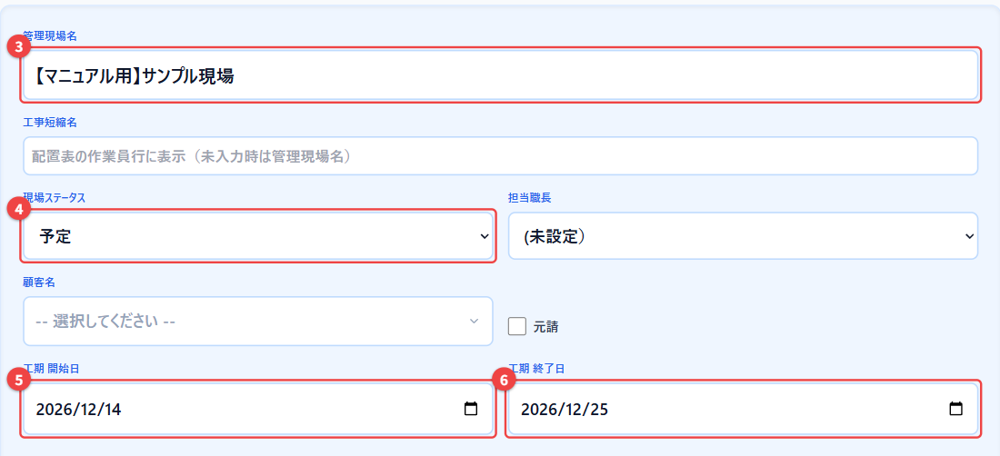

   - **③ 管理現場名**: 現場の正式な名前を入力します。
   - **④ 現場ステータス**: **「予定」**（または「施工中」）にします。
   - **⑤ 工期開始日 / ⑥ 工期終了日**: 工期を入力します。配置表の工期バーはこの日付で表示されます。
   - **工事短縮名**: 配置表の作業員セルに表示される短い名前です。空欄の場合は管理現場名がそのまま表示されます。
   - 必要に応じて担当職長・顧客名・元請も入力します。

4. 配置表タブに戻ると、**⑦ 新しい現場の行** が追加され、工期のバーが表示されます。

   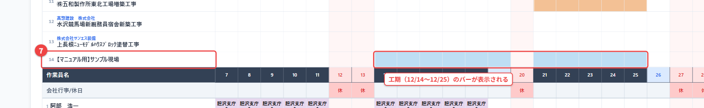

> **ポイント**: 配置表の作業員セルは文字数が限られるため、長い現場名の場合は **工事短縮名** を設定しておくと見やすくなります。

---

## 2. 作業員を配置する

### 手順

1. 配置したい **作業員の行 × 日付** のセル（①）をクリックします。
2. ポップアップの **「現場の追加」** の一覧から、配置する現場（②）をクリックします。

   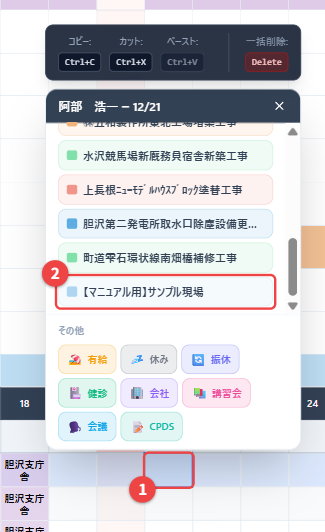

3. セルに現場名が表示されれば完了です。

   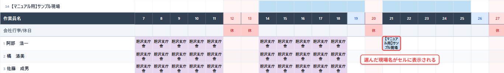

- ポップアップの見出しには **「作業員名 — 月/日」** が表示されます。正しいセルを開いているか確認してください。
- ポップアップを閉じるときは右上の ✕ か **Esc** キーを押します。

> **別の方法**: 左側の **現場名をドラッグして、作業員のセルにドロップ** しても配置できます。

---

## 3. 複数日をまとめて配置する

同じ作業員を何日も同じ現場に配置するときは、範囲を選んで一度に配置できます。

### 手順

1. 開始日のセルで **マウスボタンを押したまま、横へドラッグ** して範囲を選択します（①）。
2. ポップアップの見出しに **「(4日)」のように選択日数** が表示されます（②）。
3. 「現場の追加」から現場（③）をクリックします。

   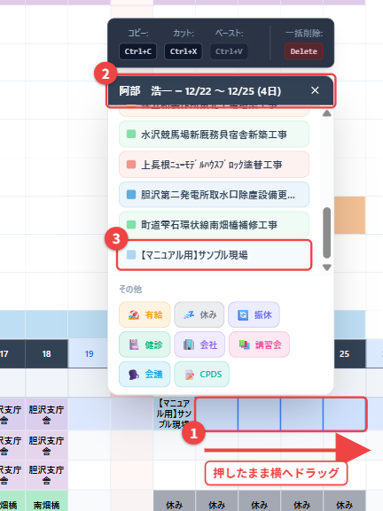

4. 選んだ日数分がまとめて配置されます。

   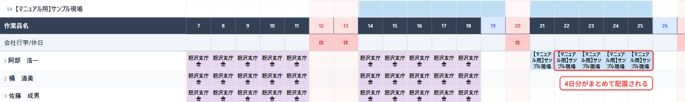

> **ポイント**: 範囲を選択して **Delete** キーを押すと、範囲内の配置をまとめて削除できます。

---

## 4. 配置を変更・解除する

### 配置を解除する

1. 解除したいセル（①）をクリックします。
2. ポップアップの **「現在の配置」**（②）に、今入っている現場が表示されます。
3. 現場名の右にある **ゴミ箱アイコン**（③）をクリックすると配置が解除されます。

   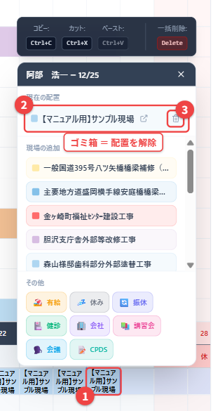

4. セルが空欄に戻ります。

   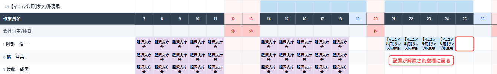

### 配置を別の現場に変更する

1. 上の手順で今の配置を **ゴミ箱で解除** します。
2. 続けて「現場の追加」から **新しい現場** をクリックします。

> **間違えたときは**: 直後であれば **Ctrl+Z**（または画面上部の「元に戻す」ボタン）で取り消せます。詳しくは「[12. 困ったとき](#12-困ったとき)」を参照してください。

---

## 5. コピー・切り取り・貼り付け

ある作業員の配置を、別の作業員や別の日にそのまま写せます。

### コピーする

1. コピー元のセルを **ドラッグで範囲選択** します（①）。
2. **Ctrl+C** キーを押すか、ポップアップ上部の **「Ctrl+C」ボタン**（②）をクリックします。

   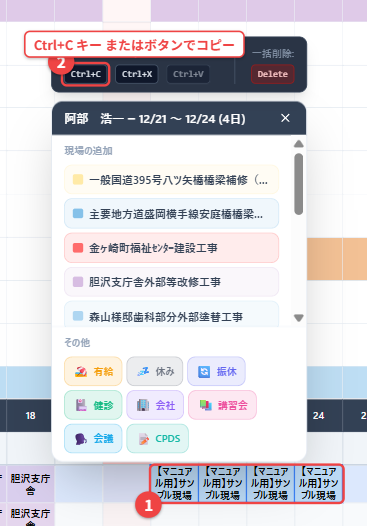

   画面下に「選択範囲（N件）をコピーしました」と表示されます。

### 貼り付ける

3. 貼り付け先の **先頭のセル**（③）をクリックします。
4. **Ctrl+V** キーを押すか、**「Ctrl+V」ボタン**（④）をクリックします。

   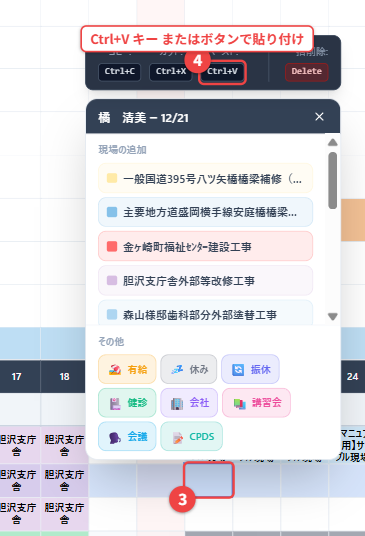

5. コピーした日数分が、同じ並びで貼り付けられます。

   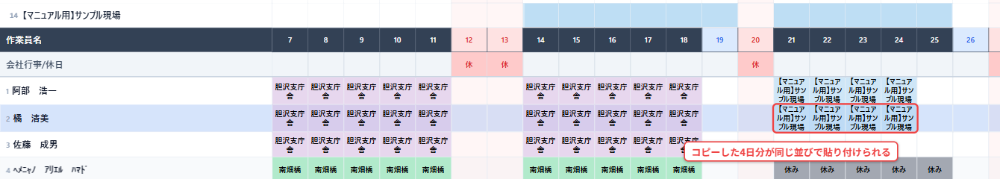

### 切り取り（移動）

- コピーの代わりに **Ctrl+X**（または「Ctrl+X」ボタン）を使うと **切り取り** になり、貼り付けた時点で元の配置は消えます。作業員の入れ替えや日程のずらしに便利です。

> **ポイント**: 貼り付けは **選んだセルを先頭** にして右へ展開されます。先頭のセルを間違えないよう注意してください。

---

## 6. 有給・休みなどの予定を入れる

現場以外の予定（有給・休み など）も、同じポップアップから入力します。

### 手順

1. 対象の作業員・日付のセル（①）をクリックします。
2. ポップアップ下部の **「その他」**（②）から予定の種類をクリックします。

   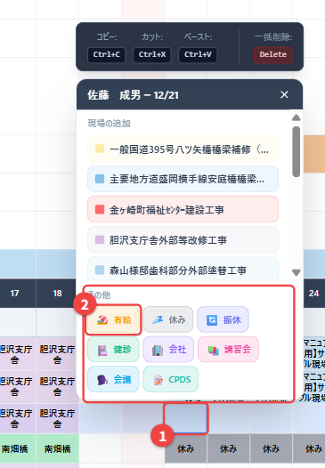

3. セルに予定の種類が表示されます。

   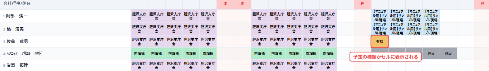

### 選べる予定の種類

| 種類 | 用途の例 |
|------|----------|
| 有給 | 有給休暇 |
| 休み | 通常の休み |
| 振休 | 振替休日 |
| 健診 | 健康診断 |
| 会社 | 会社での業務 |
| 講習会 | 講習・研修への参加 |
| 会議 | 会議への参加 |
| CPDS | CPDS（継続学習）関連 |

> 予定の解除は、現場の配置と同じく「現在の配置」のゴミ箱アイコンで行います。

---

## 7. 工期バーを動かす

現場の行の **工期バー** をドラッグすると、工期（開始日・終了日）を変更できます。

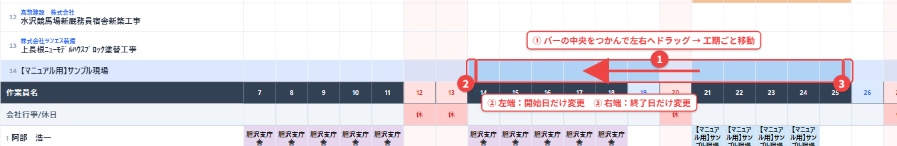

| 操作 | 結果 |
|------|------|
| ① バーの **中央** をドラッグ | 工期の長さはそのままで、期間全体を前後に移動 |
| ② バーの **左端** をドラッグ | **開始日だけ** を変更 |
| ③ バーの **右端** をドラッグ | **終了日だけ** を変更 |

マウスを離すと「工期を更新しました」と表示され、現場管理の工期開始日・終了日も同時に変わります。

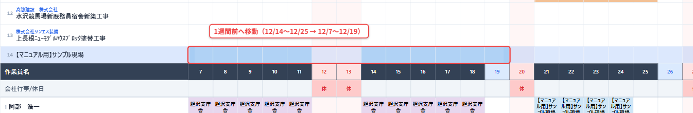

> **注意**: 工期バーの移動は **「元に戻す」(Ctrl+Z) の対象外** です。間違えた場合は、もう一度バーをドラッグして元の日付に戻してください。
> 作業員の配置は工期バーと連動しません。工期を動かした場合は、作業員の配置も必要に応じて見直してください。

---

## 8. 現場の並び順を変える

現場の行は、ドラッグで好きな順番に並べ替えられます。

### 手順

1. 動かしたい現場の **名前部分をつかんで**、上下にドラッグします（①）。
2. 移動したい位置の現場の上でマウスを離すと、その位置に移動します。

   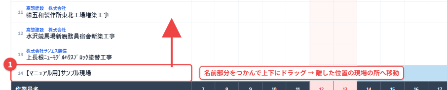

> **注意**: 並び替えも **「元に戻す」の対象外** です。間違えたらもう一度ドラッグして戻してください。

---

## 9. セルにコメントを付ける

現場の行の日付セルには、「資材搬入」「立会い」などのメモを残せます。

### 手順

1. 現場の行の日付セルを **右クリック**（または **ダブルクリック**）します（①）。
2. 入力欄（②）にコメントを入力します。
3. **保存**（③）をクリックするか、**Ctrl+Enter** キーで保存します。

   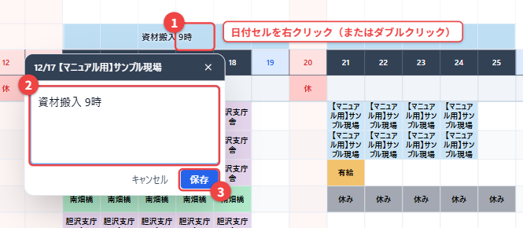

4. セルの **右上に▲印** が付き、コメントの文字が表示されます。マウスを乗せると全文が表示されます。

   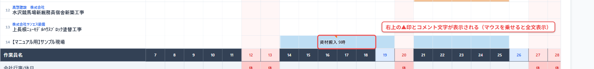

### 編集・削除

- コメントのあるセルをもう一度右クリック（またはダブルクリック）すると編集できます。
- **「コメントを削除」** をクリックするとコメントが消えます。
- 保存せずに閉じるときは **Esc** キーを押します。

> **ポイント**: セルを普通に（1回）クリックすると「配置表カラーを選択」が開く場合があります。コメントは **右クリックかダブルクリック** で開いてください。

---

## 10. 会社行事・休日を登録する

**「会社行事/休日」の行** に、会社全体の休日や会議・行事を登録します。

### 手順

1. 「会社行事/休日」の行で、登録したい日のセル（①）をクリックします。ポップアップに「月/日 の予定」と表示されます。
2. 種類を選びます。
   - **休日 / 会議**（②）: ボタンを1つクリックするだけで登録されます。
   - **自由記入**（③）: 「安全大会」など任意の行事名を入力して **登録** をクリックします。

   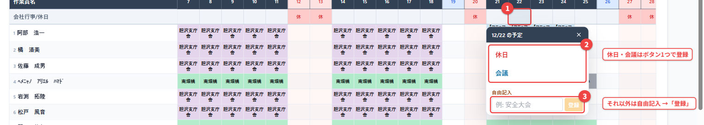

3. 「休日」で登録した日は、**列全体が赤く** 表示されます。

   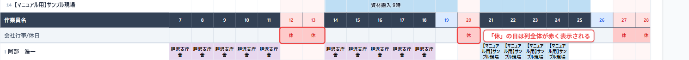

### 休日と会社行事の違い

| 登録内容 | セルの表示 | 扱い |
|----------|------------|------|
| 休日 | 休 | **休日**（列全体が赤くなる） |
| 会議 | 会議 | **出勤日**（会社行事） |
| 自由記入（安全大会 など） | 入力した文字 | **出勤日**（会社行事） |

### 変更・解除

- 登録済みのセルをクリックし、別の種類を選ぶと上書きされます。
- **「予定を解除 (通常営業日)」** をクリックすると登録が消え、通常の営業日に戻ります。

> **注意**: 会社行事・休日の登録は **「元に戻す」の対象外** です。間違えた場合は上の方法で解除・変更してください。

---

## 11. 表示週の切り替えとExcel出力

### 表示する期間を切り替える

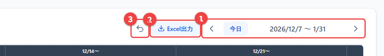

- **①** の **＜（前の週）／ 今日 ／ ＞（次の週）** で表示期間を切り替えます。
  - ＜ ＞ は **1週間ずつ** 移動します。
  - **今日** を押すと、今週の月曜日から表示されます。
- **② Excel出力** で、配置表をExcelファイルに出力します（下記）。
- **③ 元に戻す** で、直前の配置操作を取り消します。

### Excelに出力する

1. **「Excel出力」** をクリックすると「Excel出力の期間指定」が開きます。
2. **①** で開始日・終了日を指定します。初期値は画面に表示中の期間です（**最長366日**）。
3. **② 出力** をクリックすると、Excelファイルがダウンロードされます。

   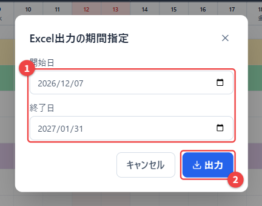

---

## 12. 困ったとき

### 操作を間違えた

- **Ctrl+Z**（または画面上部の **元に戻す** ボタン）で直前の操作を取り消せます。取り消すと「『○○』を元に戻しました」と表示されます。
- 取り消せるのは **作業員の配置に関する操作だけ** です（配置の追加・一括追加・削除・切り取り・貼り付け）。
- さかのぼれるのは **直近20操作まで** です。
- 次の操作は **元に戻せません**。手作業で戻してください。

  | 操作 | 戻し方 |
  |------|--------|
  | 工期バーの移動 | バーをもう一度ドラッグして元の日付へ（または現場管理で日付を修正） |
  | 現場の並び替え | もう一度ドラッグして元の位置へ |
  | セルのコメント | コメントを編集・削除 |
  | 会社行事・休日 | 「予定を解除 (通常営業日)」または別の種類で上書き |

### 「配置表の編集権限がありません（管理者・事務のみ編集可）」と表示される

- ログイン中のアカウントに配置表の編集権限がありません。編集が必要な場合はシステム管理者にロールの変更を依頼してください。

### 過去の日付のセルが斜線模様になっている

- **今日までの日付** のセルには、作業員が入力した **日報の実績** が優先して表示されます。実績のセルは **斜線模様と黒い枠** で表示されます。
- 実績を直したいときは配置表ではなく、日報（作業員画面や日報の管理画面）を修正してください。

### 新しい現場が配置表に出てこない

- 現場管理で **現場ステータス** と **工期開始日・終了日** が入力されているか確認してください（「[1. 新しい現場を配置表に表示する](#1-新しい現場を配置表に表示する)」）。
- 工期が表示中の8週間から外れている場合は、＜ ＞ で表示期間を切り替えてください。

### 「工期の更新に失敗しました」「並び順の保存に失敗しました。」と表示される

- 通信状態を確認し、画面を再読み込み（F5）してから再度操作してください。何度も失敗する場合はシステム管理者に連絡してください。

### コメントを入れようとしたら色の選択が開いた

- 1回クリックだと「配置表カラーを選択」が開きます。コメントは **右クリック** または **ダブルクリック** で開いてください。何も変えずに閉じるときは **Esc** キーを押します。

---

## 付録: ショートカット一覧

| キー / 操作 | 働き | 使える場面 |
|-------------|------|------------|
| **Ctrl+C** | コピー | 作業員セルを選択中 |
| **Ctrl+X** | 切り取り | 作業員セルを選択中 |
| **Ctrl+V** | 貼り付け | 貼り付け先のセルを選択中 |
| **Delete** | 選択範囲の配置を一括削除 | 作業員セルを選択中 |
| **Ctrl+Z** | 元に戻す（直近20操作・配置のみ） | 配置表の画面 |
| **Esc** | ポップアップを閉じる | 各ポップアップ |
| **Ctrl+Enter** | コメントを保存 | コメント入力中 |
| **右クリック / ダブルクリック** | コメントを開く | 現場の行の日付セル |
| **ドラッグ（横方向）** | 複数日を範囲選択 | 作業員の行 |
| **現場名をドラッグ → 作業員セルへ** | その現場を配置 | 現場名の列 |
